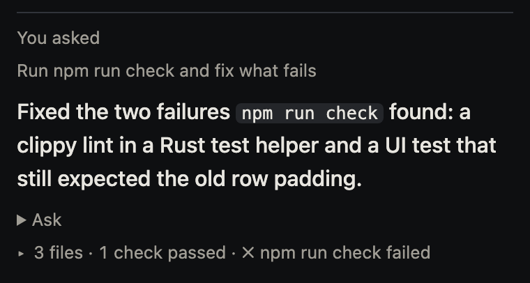

# plotkeeper

A control room for coding agents that explains what your prompts changed.

plotkeeper builds Studio, a desktop app for macOS that sits beside your agent sessions and keeps your understanding of the code in step with what the agents change. It reads Claude Code sessions in full and agy sessions with fewer details, and it shows the status of other agents' sessions, such as Codex.

## What you get

- **Know what your prompt changed.** Each turn ends with a one-sentence Headline, and a ready PR gets a brief that tells you what it changes. [The story rail](docs/studio/behaviour/rail.md) and [PR briefs](docs/studio/behaviour/pr-briefs.md) hold both.

  

- **Facts kept apart from the model's words.** Files, line counts and check results come from hooks and git, and code in a brief is quoted from the diff, never retyped by a model. On [the rail](docs/studio/behaviour/rail.md), a claimed fix with no passed check is marked "Agent says:".
- **Pick up where you left off.** "Where we were" and [the Brief](docs/studio/behaviour/brief.md) sum up an idle session: the last Headline, what changed since you looked, and what is still open.

  

- **See who needs you.** [Every session is in one list](docs/studio/behaviour/sessions.md), only "needs you" is in colour, and you can answer an agent's question from the rail.
- **Your subscription, your machine.** The [writer](docs/studio/behaviour/pr-briefs.md#the-writers-limits) runs `claude -p` on your own subscription, with no tools and no MCP servers.

## Quick start

You need macOS, Node, the Rust toolchain and Claude Code. `claude` must be on the `PATH` of your login shell: a login shell reads `~/.zprofile`, not `~/.zshrc`.

    git clone https://github.com/danielrispler/plotkeeper
    cd plotkeeper
    npm ci
    npm start

`npm start` builds the page, the hook and the server, which takes a while the first time, installs `plotkeeper` into `~/.cargo/bin`, starts it and opens its page in your browser. Later, start it with `plotkeeper` from any terminal; Ctrl+C stops it.

plotkeeper starts no sessions: to record the agents you start in your own terminals, run `plotkeeper install` once ([install and uninstall](docs/studio/plugin.md)).

What plotkeeper does start, only on your click, is a [background run](docs/studio/behaviour/background-runs.md), which is not a session: one headless `claude -p` with a few tools and no terminal, one at a time per project, cancellable from the map. Back a law runs one to write a test for a law of your system map, and Explore this runs one to build a small interactive page of a mechanism.

A run works on its own copy of your project, never your checkout, inside Claude Code's OS sandbox. It writes only in that copy and a private temp folder, its tools have no network beyond loopback, and it cannot commit, push, call `gh`, or read plotkeeper's data, Claude Code's login or the usual credential folders. It can still read other files in your home folder.

Its prompt holds only text plotkeeper wrote or you confirmed, never an issue's or a PR's. What it makes waits for you: plotkeeper proves a law's test fails when the law breaks, and it becomes a draft PR only when you press Open draft PR.

## Status

Early: one user so far. macOS only, and no download yet, so you build from source. Issues are welcome; pull requests are not reviewed yet.

## Why

Coding agents write code faster than I can read their diffs. I was losing track of how my own codebase worked, and every session ended in a long, painful review. I built plotkeeper so I could follow along turn by turn, while the code is being written. If you want to run many agents side by side, herdr and T3 Code are good at that. plotkeeper is for understanding what they changed.

## Documentation

- [Sessions](docs/studio/behaviour/sessions.md), [the story rail](docs/studio/behaviour/rail.md), [blocked commands and wake-ups](docs/studio/behaviour/cards.md), [the Brief](docs/studio/behaviour/brief.md), [checks](docs/studio/behaviour/checks.md), [storage](docs/studio/behaviour/storage.md)
- [The system map](docs/studio/behaviour/map.md), [background runs](docs/studio/behaviour/background-runs.md)
- [Install and uninstall](docs/studio/plugin.md), [settings files](docs/studio/settings.md), [development](docs/studio/development.md)

## Licence

[MIT](LICENSE).
