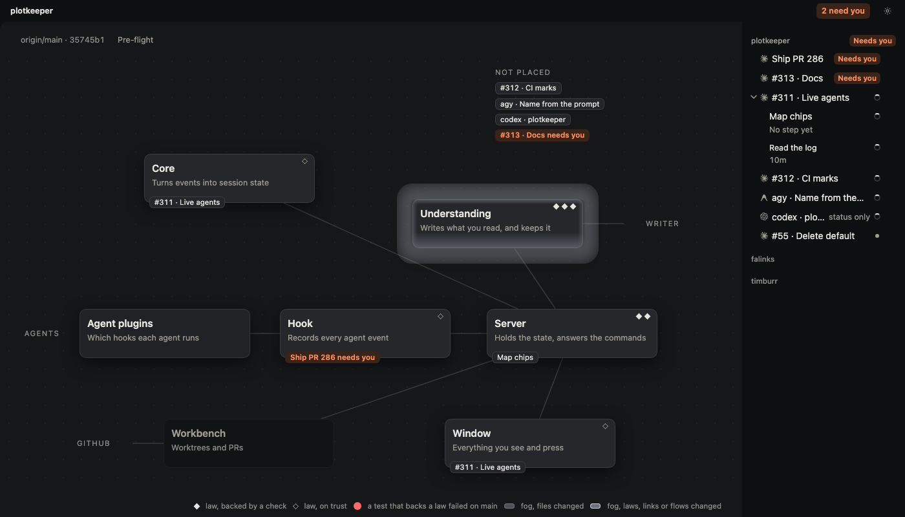

# plotkeeper

**A local macOS control room for coding agents that explains what your prompts changed.**

[](https://www.npmjs.com/package/plotkeeper)
[-black?logo=apple)](#quick-start)
[](LICENSE)

```sh
npx plotkeeper
```

> **macOS only** (Apple Silicon & Intel) · requires Node.js · Linux and Windows are not supported yet.



plotkeeper sits beside the agent sessions you already run in your own terminals and editors. It hooks into your coding agents, maps your codebase, and keeps your understanding of the code in step with what the agents change—turn by turn and PR by PR.

## What you get

- **Know what your prompt changed.** Every turn ends with a one-sentence Headline, and every ready PR gets a stepped brief tied to your [system map](docs/studio/behaviour/map.md). [The story rail](docs/studio/behaviour/rail.md) and [PR briefs](docs/studio/behaviour/pr-briefs.md) hold both.

  

- **Facts kept apart from the model's words.** Changed files, line counts and check results come from hooks and git, and code in a brief is quoted from the diff, never retyped by a model. On [the rail](docs/studio/behaviour/rail.md), a claimed fix with no passed check is marked "Agent says:".
- **Pick up where you left off.** "Where we were" and [the Brief](docs/studio/behaviour/brief.md) sum up an idle session: the last Headline, what changed since you looked, and what is still open.

  

- **See who needs you.** [Every session sits in one list](docs/studio/behaviour/sessions.md); only "needs you" is in colour, and you can answer Claude Code questions, plans and permissions straight from the page.
- **Your subscription, your machine.** The [writer](docs/studio/behaviour/pr-briefs.md#the-writers-limits) runs `claude -p` on your own subscription (or another writer in Settings), with no tools and no MCP servers.

## Supported agents

| Agent | Hooks & live status | Turn files & diffs | Answer from page | Context size |
| --- | :---: | :---: | :---: | :---: |
| **Claude Code** | Full | Yes | Yes | Yes |
| **Codex** | Full | Yes | Terminal | — |
| **Cursor** (IDE & CLI) | Full | Yes | Terminal | — |
| **agy** | Full | — | Terminal | — |

Copilot, Qwen Code, OpenCode and Cline are planned for v2.

## Quick start

**Requires macOS (Apple Silicon or Intel) and Node.js.** In any terminal, run:

```sh
npx plotkeeper
```

On first run, plotkeeper lists the agents it found and what wiring each would change, then asks once: `Wire these? [Y/n]`. Yes wires them and opens the page; in Codex, run `/hooks` once to trust its hooks. No starts it anyway without recording. Your answer is kept per agent, so later starts only ask about agents installed since. Press `Ctrl+C` to stop.

Summaries use `claude -p` by default, so `claude` must be on your login shell's `PATH` (`~/.zprofile`); Settings lets you pick another CLI or API-key writer.

| Goal | Command |
| --- | --- |
| Try once or always run latest | `npx plotkeeper` |
| Daily use (avoids ~70 s offline `npx` wait) | `npm i -g plotkeeper && plotkeeper` |
| Wire all detected agents (including declined) | `plotkeeper install` (add `--yes` for scripts) |
| Remove all hook wiring (keeps history) | `plotkeeper uninstall` |
| Build from source (needs Rust toolchain) | `git clone ... && npm ci && npm start` |

Offline with `npx`, pass `npx --prefer-offline plotkeeper`. See [install and uninstall](docs/studio/plugin.md) for full details.

## Local-first & privacy

- **Local only:** serves on `127.0.0.1` behind a per-run token; hook events stay on your machine.
- **Consent & credential safety:** asks before wiring, never opens `~/.claude/settings.json`, `~/.codex/config.toml` or any credential file, and cleanly undoes all wiring on `plotkeeper uninstall`.
- **Sandboxed background runs:** plotkeeper never starts sessions on its own. Only on your click does it launch a [background run](docs/studio/behaviour/background-runs.md) (`claude -p` on a copy of your project) to back a law with a test or explain a mechanism.
- **Strict isolation:** background runs stay inside Claude Code's OS sandbox (no network beyond loopback, no git push or `gh`, no access to credential folders), and draft PRs open only when you click **Open draft PR**.

## Why

Coding agents write code faster than I can read their diffs. I was losing track of how my own codebase worked, and every session ended in a long, painful review. I built plotkeeper so I could follow along turn by turn, while the code is being written. If you want to run many agents side by side, herdr and T3 Code are great at that. plotkeeper is for understanding what they changed.

## Status

Early preview · **macOS only** (Apple Silicon and Intel). Issues are welcome; pull requests are not reviewed yet.

## Documentation

- [Sessions](docs/studio/behaviour/sessions.md), [the story rail](docs/studio/behaviour/rail.md), [blocked commands and wake-ups](docs/studio/behaviour/cards.md), [the Brief](docs/studio/behaviour/brief.md), [checks](docs/studio/behaviour/checks.md), [storage](docs/studio/behaviour/storage.md)
- [The system map](docs/studio/behaviour/map.md), [PR briefs](docs/studio/behaviour/pr-briefs.md), [background runs](docs/studio/behaviour/background-runs.md)
- [Install and uninstall](docs/studio/plugin.md), [settings files](docs/studio/settings.md), [development](docs/studio/development.md)

## Licence

[MIT](LICENSE).
