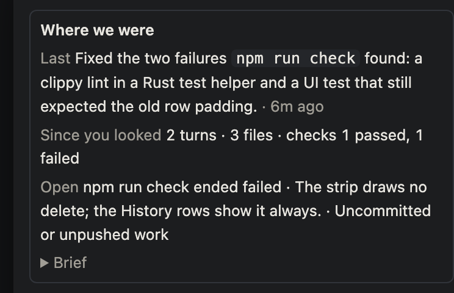

# plotkeeper

**A local macOS control room for coding agents that explains what your prompts changed.**

[](https://www.npmjs.com/package/plotkeeper)
[-black?logo=apple)](#quick-start)
[](LICENSE)

```sh
npx plotkeeper
```


plotkeeper sits beside the sessions you run in your own terminals and editors. It hooks into your coding agents, tracks unseen changes as [Fog](docs/studio/behaviour/map.md) on your system map, and keeps your understanding in step turn by turn and PR by PR.

## What you get

- **Know what your prompt changed.** Every turn ends with a one-sentence Headline, and ready PRs get a stepped brief on your [system map](docs/studio/behaviour/map.md). [The story rail](docs/studio/behaviour/rail.md) and [PR briefs](docs/studio/behaviour/pr-briefs.md) hold both.

  

- **Facts apart from model words.** Files, line counts and check results come from hooks and git; brief code is quoted from the diff, never retyped. On [the rail](docs/studio/behaviour/rail.md), an unverified fix is marked "Agent says:".
- **Pick up where you left off.** "Where we were" and [the Brief](docs/studio/behaviour/brief.md) sum up an idle session: the last Headline, what changed since you looked, and what is open.

  

- **See who needs you.** [Every session sits in one list](docs/studio/behaviour/sessions.md); only "needs you" is in colour, and you can answer Claude Code questions, plans and permissions from the page.
- **Your subscription, your machine.** The [writer](docs/studio/behaviour/pr-briefs.md#the-writers-limits) runs `claude -p` (or another writer in Settings) with no tools and no MCP servers.

## Supported agents

| Agent | Live turns | Turn diffs | Answer in page | Context |
| --- | :---: | :---: | :---: | :---: |
| **Claude Code** | Full | Yes | Yes | Yes |
| **Codex** | Hooks | Yes | — | — |
| **Cursor** (IDE & CLI) | Finished calls | Yes | — | — |
| **Antigravity CLI** (agy) | Hooks + transcript | — | — | — |

Copilot and Qwen Code are experimental (wired, untrialled); OpenCode and Cline are planned for v2.

## Quick start

**macOS only** (Apple Silicon & Intel) with Node.js. Run `npx plotkeeper`: first start lists detected agents and asks `Wire these? [Y/n]`. Yes wires them and opens the page (in Codex, run `/hooks` once to trust its hooks); No starts without recording. Answers are kept per agent; `Ctrl+C` stops plotkeeper.

Summaries default to `claude -p` (`claude` on `~/.zprofile` `PATH`); Settings picks another CLI or API-key writer.

- **Daily use:** `npm i -g plotkeeper && plotkeeper` (avoids ~70 s offline `npx` wait; or `npx --prefer-offline plotkeeper`).
- **CLI:** `plotkeeper install` (`--yes` for scripts), `plotkeeper uninstall` (undoes wiring, keeps history; [details](docs/studio/plugin.md)), `plotkeeper --version`.
- **From source** (Rust): `git clone ... && npm ci && npm start`.

## Local-first & privacy

- **Local only:** serves on `127.0.0.1` with a per-run token; events stay local, and the writer uses your subscription with no tools.
- **Consent & credentials:** asks before wiring, never opens `~/.claude/settings.json`, `~/.codex/config.toml` or credential files; `plotkeeper uninstall` reverses everything.
- **Sandboxed background runs:** never starts sessions unasked. Only on your click does a [background run](docs/studio/behaviour/background-runs.md) run `claude -p` on a project copy inside Claude Code's OS sandbox (loopback only, no push/`gh`, no credentials); draft PRs open only on **Open draft PR**.

## Why

Coding agents write code faster than I can read their diffs. I was losing track of how my own codebase worked, and every session ended in a long, painful review. I built plotkeeper so I could follow along turn by turn, while the code is being written. If you want to run many agents side by side, herdr and T3 Code are good at that. plotkeeper is for understanding what they changed.

## Status

Early preview · **macOS only** (Apple Silicon and Intel). Issues are welcome; pull requests are not reviewed yet.

## Documentation

- [Sessions](docs/studio/behaviour/sessions.md), [the story rail](docs/studio/behaviour/rail.md), [blocked commands and wake-ups](docs/studio/behaviour/cards.md), [the Brief](docs/studio/behaviour/brief.md), [checks](docs/studio/behaviour/checks.md), [storage](docs/studio/behaviour/storage.md)
- [The system map](docs/studio/behaviour/map.md), [PR briefs](docs/studio/behaviour/pr-briefs.md), [background runs](docs/studio/behaviour/background-runs.md)
- [Install and uninstall](docs/studio/plugin.md), [settings files](docs/studio/settings.md), [development](docs/studio/development.md)

## Licence

[MIT](LICENSE).
